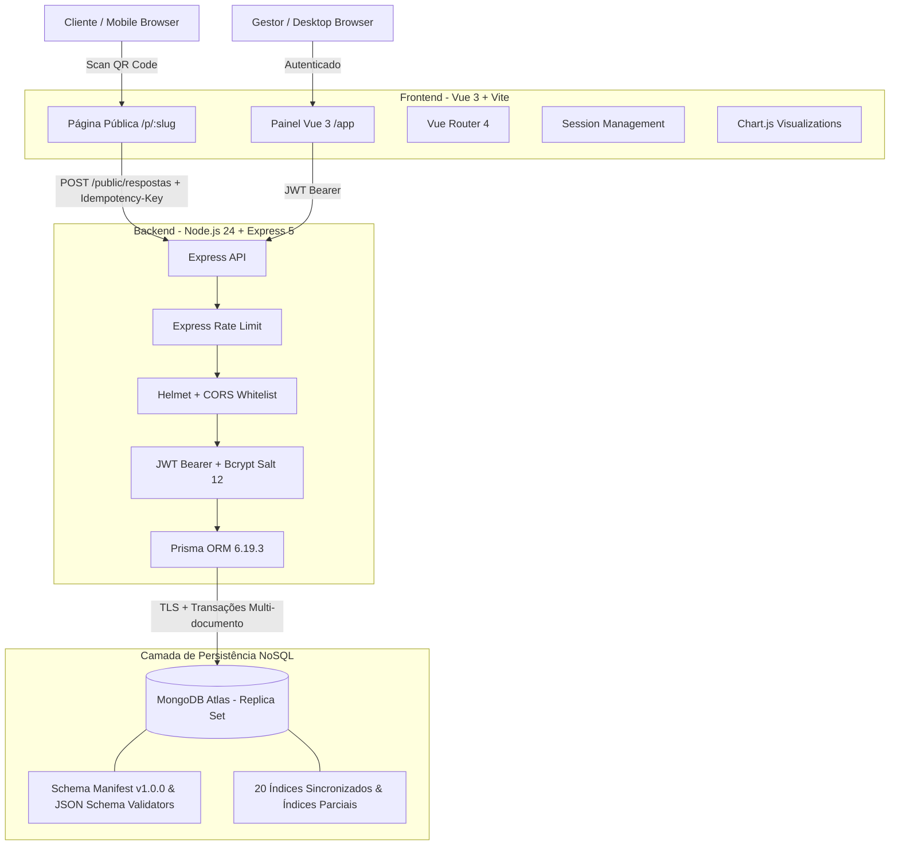

# FeedQR — Plataforma de Pesquisas e Feedback por QR Code

> Sistema completo de coleta, análise e inteligência de feedback via QR Code, com persistência NoSQL distribuída no MongoDB Atlas, arquitetura multi-tenant transacional, interface responsiva em Vue 3 e garantias formais de idempotência e segurança.

[](https://nodejs.org/)
[](https://expressjs.com/)
[](https://www.mongodb.com/atlas)
[](https://www.prisma.io/)
[](https://vuejs.org/)
[](https://vitejs.dev/)
[-2EAD33?logo=playwright&logoColor=white)](https://playwright.dev/)
[-6E9F18?logo=vitest&logoColor=white)](https://vitest.dev/)

---

## 1. Visão Geral e Problema Resolvido

No varejo, restaurantes e serviços presenciais, coletar a opinião dos clientes no momento exato da experiência é um dos maiores desafios operacionais. Formulários longos, logins obrigatórios e links lentos afastam o consumidor.

O **FeedQR** resolve esse problema oferecendo uma esteira ponta a ponta:
1. **Pontos de Coleta Físicos:** Criação de pontos de coleta geolocalizados/setorizados (ex.: "Mesa 04", "Balcão", "Recepção") com geração automática de QR Codes de alta precisão em formato PNG.
2. **Experiência Pública Instantânea e Sem Fricção:** O cliente escaneia o QR Code em seu dispositivo móvel e responde uma pesquisa fluida, pergunta a pergunta, sem exigir cadastro, aplicativo nativo ou autenticação prévia.
3. **Resiliência em Rede Instável:** Persistência no dispositivo (`sessionStorage`) contra recarregamentos acidentais e submissão transacional com chave de idempotência (`Idempotency-Key` + hash SHA-256), garantindo que conexões lentas ou cliques duplos nunca dupliquem avaliações.
4. **Inteligência em Tempo Real:** Painel administrativo corporativo para acompanhamento de métricas (NPS, satisfação com estrelas 1-5, perguntas booleanas e textos livres), gráficos temporais UTC e exportação streaming de relatórios CSV.

---

## 2. Principais Funcionalidades

### 📋 Gestão de Pesquisas e Perguntas
- Ciclo de vida estrito por máquina de estados: `RASCUNHO` $\rightarrow$ `ATIVA` $\rightarrow$ `ENCERRADA`.
- Rascunhos editáveis com bloqueio estrito contra alterações após publicação.
- Cinco tipos de perguntas suportados:
  - **Estrelas (1 a 5):** Avaliação de qualidade e atendimento.
  - **NPS (0 a 10):** Cálculo automatizado de Promotores (9-10), Neutros (7-8), Detratores (0-6) e Score líquido.
  - **Sim / Não:** Perguntas binárias objetivas.
  - **Texto Livre:** Comentários abertos de até 2.000 caracteres.
  - **Múltipla Escolha:** Alternativas customizadas com ordenação visual garantida.
- Identificador público canônico amigável via `slug` customizável ou UUID v4.

### 📱 Pontos de Coleta e QR Codes
- Criação de múltiplos pontos de coleta por pesquisa para rastreabilidade de origem.
- Geração instantânea de QR Code PNG (512x512, correção de erro nível M).
- Desativação suave de pontos de coleta com respostas vinculadas (preservando o histórico estatístico e bloqueando novas coletas).

### 🚀 Fluxo Público de Avaliação
- Interface responsiva testada em dispositivos móveis (360px a 430px) e desktops (até 1440px).
- Transições suaves e navegação sequencial com suporte a teclado e respeito ao `prefers-reduced-motion`.
- Sanitização de entrada e prevenção contra submissões simultâneas conflitantes.

### 📊 Analytics, Gráficos e Exportação CSV
- Agrupamento temporal de respostas por dia utilizando pipeline nativo de agregação do MongoDB em timezone UTC.
- Filtros por período (`inicio` e `fim`), pesquisa e ponto de coleta.
- Paginação de feedbacks com ordenação cronológica decrescente.
- Exportação segura de relatórios em CSV:
  - Streaming assíncrono com cursor em lotes de 100 registros para evitar estouro de memória.
  - Codificação UTF-8 com BOM (`\uFEFF`) para compatibilidade perfeita com Microsoft Excel e Google Sheets.
  - Sanitização automática contra injeção de fórmulas CSV (prefixando caracteres `=`, `+`, `-`, `@` com apóstrofo).

---

## 3. Arquitetura e Stack Tecnológica



### Tecnologias Utilizadas
- **Runtime:** Node.js 24+ (ES Modules nativos).
- **Servidor Web:** Express 5.2+.
- **ORM / Mapeador de Dados:** Prisma 6.19.3 (com `provider = "mongodb"` e `relationMode = "prisma"`).
- **Banco de Dados Oficial:** MongoDB Atlas (Cluster remoto com Replica Set gravável, suporte a transações ACID multi-documento e validação estrita via JSON Schema).
- **Segurança & Criptografia:** JWT (HS256 com verificação de sujeito UUID), Bcrypt (custo de hashing 12 com proteção de tempo constante para usuários inexistentes), Helmet, CORS com whitelist dinâmica.
- **Frontend SPA:** Vue 3.5 (Composition API), Vite 8.3, Vue Router 4, Chart.js, Lucide Icons, tipografia IBM Plex Sans.
- **Validação de Schemas:** Zod 4.6 (em runtime no backend e frontend).
- **Geração de QR Codes:** biblioteca `qrcode` gerando buffers PNG otimizados.

---

## 4. Segurança e Robustez

- **Isolamento Multi-tenant Estrito:** Todas as operações administrativas filtram os registros pelo `empresaId` derivado do token JWT do usuário autenticado no banco. Nenhuma consulta confia em identificadores recebidos no corpo ou nos parâmetros da requisição.
- **Transações e Concorrência:** As submissões de respostas utilizam transações atômicas com coordenação via versionamento otimista (`Pesquisa.writeVersion`), evitando inconsistências sob alta concorrência.
- **Tratamento de WriteConflict e Idempotência:** Implementação de algoritmo de retry com **backoff exponencial e jitter aleatório** para lidar com conflitos transitórios do MongoDB, além de índice parcial em `Resposta.idempotencyKey` com hash SHA-256 do payload.
- **Rate Limiting Granular:**
  - Autenticação (`/api/auth`): máximo de 10 requisições por IP a cada 15 minutos.
  - Leitura pública (`/api/public/pesquisas/:slug`): até 120 requisições por IP a cada 15 min.
  - Envio de respostas (`/api/public/.../respostas`): até 30 envios por IP a cada 15 min.
  - Rotas administrativas: até 300 requisições por IP a cada 15 min.
  - Exportação de CSV: até 5 downloads a cada 15 min por usuário autenticado.
- **Suporte a Reverse Proxy:** Suporte à variável `TRUST_PROXY` para leitura fidedigna do `X-Forwarded-For` atrás de Cloudflare, Render, Railway ou Nginx.
- **Prevenção contra Exposição de Dados:** Senhas em hash nunca são retornadas nas APIs, `app.disable('x-powered-by')` ativado, `Cache-Control: no-store` em respostas com dados sensíveis e sanitização de logs garantindo que URIs completas e senhas nunca apareçam no terminal.

---

## 5. Como Executar Localmente

### Pré-requisitos
- Node.js 24 ou superior instalado (`node -v`).
- Instância do MongoDB com Replica Set ativo (local ou cluster gratuito no MongoDB Atlas).

### 1. Clonar o repositório e instalar dependências
```bash
git clone https://github.com/olucasortiz/qrcode-avaliacao.git
cd qrcode-avaliacao

# Instalar dependências da raiz (backend) e do frontend
npm install
npm --prefix frontend install
```

### 2. Configurar variáveis de ambiente
Copie o modelo de ambiente da raiz:
```bash
cp .env.example .env
```
Edite o arquivo `.env` com suas credenciais:
```ini
PORT=3000
NODE_ENV=development
DATABASE_URL="mongodb+srv://<usuario>:<senha>@<cluster-host>/feedqr?retryWrites=true&w=majority&appName=cluster-qrcode"
JWT_SECRET="insira_aqui_um_segredo_aleatorio_com_mais_de_32_caracteres"
FRONTEND_PUBLIC_URL="http://127.0.0.1:5173"
CORS_ORIGINS="http://127.0.0.1:5173,http://localhost:5173"
TRUST_PROXY=false
```

Para gerar um segredo JWT seguro localmente:
```bash
node -e "console.log(require('crypto').randomBytes(32).toString('hex'))"
```

Configure também o arquivo `frontend/.env.local` (opcional em ambiente local com proxy do Vite):
```ini
VITE_API_BASE_URL=/api
API_PROXY_TARGET=http://127.0.0.1:3000
VITE_FRONTEND_PUBLIC_URL=http://127.0.0.1:5173
```

### 3. Sincronizar o Schema Manifest e gerar o Prisma Client
Para aplicar os 20 índices e validators JSON Schema no MongoDB:
```bash
# Sincronizar índices e validators declarativos no banco
npm run mongo:sync -- --apply

# Gerar o client tipado do Prisma para MongoDB
npm run prisma:generate
```

### 4. Executar em modo de desenvolvimento
Em um terminal (iniciar a API):
```bash
npm run dev
```

Em um segundo terminal (iniciar o frontend):
```bash
npm run frontend:dev
```

Acesse o sistema em: `http://127.0.0.1:5173`.

---

## 6. Scripts Disponíveis

| Comando | Descrição |
| :--- | :--- |
| `npm run dev` | Inicia o backend com Nodemon (watch nos arquivos de `src/`). |
| `npm start` | Inicia o servidor HTTP de produção com Node.js nativo. |
| `npm run build` | Compila o Prisma Client e o bundle estático do frontend com Vite. |
| `npm test` | Executa todos os 61 testes automatizados do backend (Vitest). |
| `npm run frontend:test` | Executa os 62 testes unitários do frontend (Vitest). |
| `npm run frontend:e2e` | Executa os 64 testes End-to-End no navegador Chromium (Playwright). |
| `npm run mongo:sync` | Inspeciona e sincroniza coleções, índices e validators no MongoDB Atlas. |
| `npm run mongo:verify-atlas` | Testa e valida a conectividade, TLS, réplica set e conformidade com o Atlas. |
| `npm run mongo:migrate` | Executa o pipeline de migração do SQLite original para o MongoDB. |
| `npm run mongo:rollback` | Executa o rollback seguro dos dados do MongoDB de volta para SQLite. |
| `npm audit` | Executa auditoria de vulnerabilidades em dependências npm. |

---

## 7. Como Gerar uma Pesquisa e Coletar Feedback

1. **Criar Conta / Login:** Acesse `http://127.0.0.1:5173/cadastro` e registre uma nova empresa ou entre com suas credenciais.
2. **Nova Pesquisa:** No painel principal (`/app/pesquisas`), clique em **"Nova pesquisa"**, preencha o título (ex.: *"Satisfação do Atendimento"*) e a descrição.
3. **Estruturar Perguntas:**
   - Adicione perguntas escolhendo entre os 5 tipos disponíveis (Estrelas, NPS, Sim/Não, Texto ou Múltipla Escolha).
   - Configure a obrigatoriedade e ordene as perguntas.
4. **Adicionar Pontos de Coleta:**
   - Crie pontos físicos (ex.: *"Caixa 01"*, *"Salão Principal"*).
   - Clique em **"Baixar QR Code"** para obter a imagem PNG de alta resolução.
5. **Publicar Pesquisa:**
   - Clique no botão **"Publicar pesquisa"**. A pesquisa mudará para o status `ATIVA` e estará pronta para receber respostas públicas.
6. **Responder via QR Code ou Link Direto:**
   - Escaneie o QR Code com a câmera do celular ou abra a URL direta: `http://127.0.0.1:5173/p/<slug>?origem=<token>`.
   - Responda às perguntas e envie.
7. **Analisar Resultados:**
   - Volte ao painel administrativo da pesquisa para visualizar o gráfico diário de volume de respostas, a média de estrelas, o cálculo do NPS, o gráfico de distribuição de escolhas e a lista paginada de feedbacks.
   - Clique em **"Exportar CSV"** para baixar a planilha completa.

---

## 8. Estrutura do Repositório

```
qrcode-avaliacao/
├── docs/                      # Relatórios formais de engenharia de cada etapa (etapa-1 a etapa-9)
├── prisma/
│   ├── schema.prisma          # Schema definitivo MongoDB Prisma 6.19.3
│   ├── schema.mongo.prisma    # Cópia de trabalho do schema MongoDB
│   └── schema.sqlite.prisma   # Schema legado SQLite preservado para rollback
├── scripts/
│   ├── sync-mongodb.js        # Sincronizador declarativo de índices e validators JSON Schema
│   ├── migrate-sqlite-to-mongo.js # Migrador com preflight, dry-run, import e verify
│   ├── rollback-mongo-to-sqlite.js # Ferramenta de rollback MongoDB -> SQLite
│   ├── verify-atlas.js        # Script de diagnóstico de conexão e conformidade Atlas
│   └── preserve-sqlite-baseline.js # Utilitário de snapshot e integridade SQLite
├── src/
│   ├── config/
│   │   ├── env.js             # Validação estrita de variáveis de ambiente com Zod
│   │   ├── prisma.js          # Inicialização singleton, health check e shutdown do Prisma
│   │   └── mongo/
│   │       └── schemaManifest.js # Schema Manifest v1.0.0 (8 coleções, 20 índices, $jsonSchema)
│   ├── controllers/           # Camada de controle Express
│   ├── middlewares/           # Autenticação JWT, Rate Limiting, Helmet, Error Handler
│   ├── routes/                # Rotas públicas (/public), administrativas e de autenticação
│   ├── services/              # Regras de negócio, transações, idempotência e agregações
│   ├── utils/                 # Schemas Zod, sanitização CSV e helpers de data UTC
│   ├── app.js                 # Configuração centralizada do Express
│   └── server.js              # Inicialização do servidor HTTP e Graceful Shutdown
├── frontend/
│   ├── src/
│   │   ├── components/        # Componentes visuais desacoplados e acessíveis
│   │   ├── layouts/           # Layouts de autenticação e administrativo
│   │   ├── lib/               # Cliente HTTP seguro com fetch, schemas Zod e formatação
│   │   ├── router/            # Vue Router com guards de autenticação e restauração de sessão
│   │   ├── services/          # Serviços de integração com a API REST
│   │   ├── styles/            # Design system, tokens CSS e suporte a tema/movimento reduzido
│   │   └── views/             # Telas do sistema (Dashboard, Pesquisas, Detalhes, Formulário Público)
│   └── tests/
│       ├── unit/              # 62 testes unitários do frontend (Vitest)
│       └── e2e/               # 64 testes ponta a ponta no Chromium (Playwright)
└── tests/                     # 61 testes de integração do backend (Vitest + MongoMemoryServer)
```

---

## 9. Suíte de Testes e Validação de Qualidade

O FeedQR conta com **187 testes automatizados** distribuídos em três camadas, todos em execução contínua com 100% de taxa de aprovação:

| Camada | Ferramenta | Quantidade | Escopo |
| :--- | :--- | :--- | :--- |
| **Backend Integration** | Vitest 5 + MongoMemoryServer | **61 testes** | Autenticação, isolamento multi-tenant, ciclo de vida de pesquisas, concorrência, idempotência transacional, agregação UTC, exportação CSV, migração e rollback. |
| **Frontend Unit** | Vitest 5 | **62 testes** | Validação de schemas Zod, cliente HTTP seguro, gerenciamento de sessão, formulários reativos e armazenamento local resiliente. |
| **Frontend E2E** | Playwright 1.64 (Chromium) | **64 testes** | Testes no navegador real em 4 resoluções (360px mobile, 768px tablet, 1024px e 1440px desktop), fluxos completos de resposta via QR Code, acessibilidade, navegação por teclado e simulação de instabilidade de rede. |

Para rodar todas as suítes:
```bash
# 1. Testes de Backend
npm test

# 2. Testes de Frontend
npm run frontend:test

# 3. Testes End-to-End
npm run frontend:e2e
```

---

## 10. Estratégia de Deploy em Produção

O FeedQR foi arquitetado para uma divisão desacoplada e econômica:
1. **Frontend (SPA Estático):** Pode ser implantado em plataformas globais de borda como **Cloudflare Pages**, **Vercel** ou **Netlify**, com build gerado por `npm run frontend:build`.
2. **Backend (Node.js Service):** Pode ser hospedado em plataformas de container como **Render**, **Railway**, **Fly.io** ou VPS gerenciada.
   - Health check de Liveness: `GET /api/health`
   - Health check de Readiness: `GET /api/health/ready` (valida conexão com MongoDB Atlas)
   - Graceful Shutdown automático em `SIGINT`/`SIGTERM` para fechar conexões HTTP e Prisma sem perder requisições em trânsito.
3. **Banco de Dados (MongoDB Atlas):** Cluster gerenciado com réplica set ativo, TLS obrigatório e credenciais seguras via variável de ambiente `DATABASE_URL`.

---

## 11. Limitações Conhecidas e Boas Práticas

- **Revogação Instantânea de JWT:** Por adotar tokens JWT sem estado com expiração de 1 hora, o logout encerra a sessão no cliente (`sessionStorage`), e as rotas administrativas validam a existência do usuário no banco a cada requisição. Revogação instantânea de tokens por lista de bloqueio (blacklist/Redis) pode ser adicionada caso haja necessidade de invalidação forçada antes do término do tempo de vida do token.
- **Limitação de Exportação CSV:** O download de relatórios em CSV é limitado a 5 requisições a cada 15 minutos por usuário para proteger o banco de dados contra scraping ou sobrecarga acidental.
- **Preservação de Dados de Amostra:** O banco de dados SQLite original (`prisma/dev.db`, SHA-256 verificado `15207b88446f8be4a86e9defab2995bd444980ce52153a64bf538aaef57500c4`) e seus backups em `backups/` permanecem preservados e intactos para fins de auditoria e rollback.
