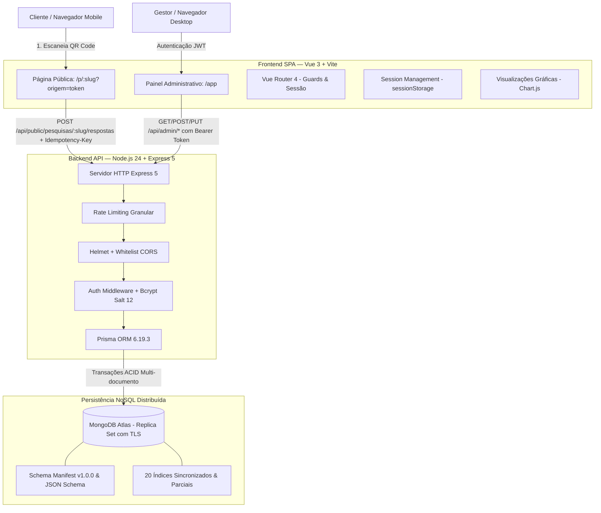

# FeedQR — Plataforma de Pesquisas e Feedback por QR Code

> Solução completa de inteligência e coleta de feedback em tempo real no ponto de experiência, com arquitetura NoSQL distribuída no MongoDB Atlas, backend transacional em Node.js 24 + Express 5, frontend responsivo em Vue 3 + Vite e garantias formais de idempotência, segurança multi-tenant e integridade.

[](https://nodejs.org/)
[](https://expressjs.com/)
[](https://www.mongodb.com/atlas)
[](https://www.prisma.io/)
[](https://vuejs.org/)
[](https://vitejs.dev/)
[-2EAD33?logo=playwright&logoColor=white)](https://playwright.dev/)
[-6E9F18?logo=vitest&logoColor=white)](https://vitest.dev/)

---

## 1. Visão Geral e Problema Resolvido

No varejo, restaurantes, clínicas e serviços presenciais, obter a avaliação genuína do cliente durante a experiência é um grande gargalo: formulários longos, exigência de login, downloads de aplicativos e páginas lentas desmotivam as respostas.

O **FeedQR** resolve esse problema através de um fluxo contínuo e sem fricção:

1. **Pontos de Coleta Setorizados:** Criação de pontos de coleta físicos (ex.: *"Mesa 04"*, *"Balcão"*, *"Recepção"*) com geração dinâmica de QR Codes de alta precisão em formato PNG.
2. **Experiência Pública Instantânea:** O consumidor aponta a câmera do celular para o QR Code e acessa uma pesquisa rápida, sequencial e intuitiva, sem necessidade de cadastro, autenticação ou aplicativo instalado.
3. **Resiliência e Idempotência Sob Rede Instável:** Persistência no dispositivo (`sessionStorage`) contra recarregamento acidental e submissão transacional com chave de idempotência (`Idempotency-Key` + hash SHA-256), assegurando que conexões instáveis ou cliques duplos nunca dupliquem avaliações.
4. **Inteligência e Analytics em Tempo Real:** Painel administrativo corporativo para acompanhamento de métricas (NPS, estrelas 1-5, perguntas booleanas e textos livres), gráficos temporais em UTC e exportação streaming de relatórios em CSV.

---

## 2. Principais Funcionalidades

### 📋 Gestão de Pesquisas e Perguntas
- **Ciclo de vida estrito por máquina de estados:** `RASCUNHO` $\rightarrow$ `ATIVA` $\rightarrow$ `ENCERRADA`.
- Rascunhos totalmente editáveis; bloqueio estrito contra alterações de perguntas após a ativação pública.
- Versionamento otimista de concorrência via `writeVersion` no nível do documento da pesquisa.
- **5 tipos de perguntas suportados:**
  - ⭐ **Estrelas (1 a 5):** Avaliação de atendimento, satisfação ou qualidade.
  - 📈 **NPS (0 a 10):** Cálculo automático de Promotores (9-10), Neutros (7-8), Detratores (0-6) e Net Promoter Score líquido (-100 a +100).
  - 🔘 **Sim / Não:** Perguntas binárias objetivas com tratamento de booleano `false` sem descarte.
  - 💬 **Texto Livre:** Comentários abertos de até 2.000 caracteres com sanitização.
  - 🔠 **Múltipla Escolha:** Alternativas customizáveis com ordenação sequencial garantida.
- Identificador público canônico amigável via `slug` customizável ou UUID v4.

### 📱 Pontos de Coleta e QR Codes
- Criação e rastreabilidade de múltiplos pontos de coleta por pesquisa.
- Geração instantânea de QR Code PNG (512x512 px, correção de erro nível M).
- Desativação suave de pontos de coleta vinculados a respostas (preserva o histórico analítico e impede novas submissões).

### ⚡ Fluxo Público de Avaliação
- Interface mobile-first testada em dispositivos móveis (360px a 430px) e desktops (até 1440px).
- Transições fluidas pergunta a pergunta, suporte integral a teclado e respeito à diretiva de acessibilidade `prefers-reduced-motion`.
- Armazenamento temporário de respostas no navegador para tolerância a falhas de rede antes da submissão final.

### 📊 Analytics, Gráficos e Exportação CSV
- Agrupamento temporal de respostas por dia através de pipeline nativo de agregação do MongoDB em timezone UTC (`$dateToString`).
- Filtros dinâmicos por período (`inicio` e `fim`), pesquisa e ponto de coleta.
- Paginação de feedbacks com ordenação cronológica decrescente.
- **Exportação de relatórios em CSV:**
  - Streaming assíncrono com cursor em lotes de 100 registros (baixo consumo de memória).
  - Codificação UTF-8 com BOM (`\uFEFF`) para compatibilidade nativa com Microsoft Excel, LibreOffice e Google Sheets.
  - Sanitização automática contra injeção de fórmulas CSV (prefixando caracteres `=`, `+`, `-`, `@` com apóstrofo).

---

## 3. Arquitetura da Solução & Stack Tecnológica



### Stack Tecnológica Detalhada

| Camada | Tecnologia | Versão | Responsabilidade |
| :--- | :--- | :--- | :--- |
| **Runtime** | Node.js | 24+ LTS | Ambiente de execução JavaScript com ES Modules nativos. |
| **Servidor Web** | Express | 5.2+ | Roteamento REST, middlewares de segurança e tratamento global de erros. |
| **ORM / Mapeador** | Prisma | 6.19.3 | Mapeamento declarativo, geração de tipos e queries para MongoDB. |
| **Banco de Dados** | MongoDB Atlas | 6.0+ | Cluster gerenciado com Replica Set, transações ACID e $jsonSchema. |
| **Frontend Framework** | Vue.js | 3.5+ | Interface reativa orientada a componentes (Composition API). |
| **Build & Tooling** | Vite | 8.3+ | Bundler ultra-rápido, HMR e compilação otimizada de produção. |
| **Roteamento SPA** | Vue Router | 5.4+ | Navegação client-side com guards de rota e restauração de sessão. |
| **Validação de Schemas** | Zod | 4.6+ | Validação rigorosa em runtime no backend (DTOs) e frontend (formulários). |
| **Segurança & Cripto** | Bcrypt / JWT | 6.0 / 9.0 | Hashing de senhas com custo 12 (timing mitigation) e tokens HS256 (1h). |
| **Visualização** | Chart.js | 4.5+ | Gráficos diários de volume de respostas e distribuição de notas. |
| **Geração de QR Code**| qrcode | 1.5+ | Criação de matrizes binárias e buffers de imagem PNG (512x512). |
| **Ícones & Tipografia** | Lucide / IBM Plex | 1.52 / 5.3 | Design system coerente, acessível e minimalista. |

---

## 4. Estrutura Modular do Repositório

O projeto é organizado de maneira modular e desacoplada em pastas especializadas:

```
qrcode-avaliacao/
├── backend/                       # Serviço Backend (API REST, Prisma e Migrações)
│   ├── .env.example               # Modelo documentado de variáveis de ambiente do backend
│   ├── package.json               # Dependências e scripts do servidor Node.js
│   ├── prisma/
│   │   ├── schema.prisma          # Schema definitivo MongoDB Prisma 6.19.3
│   │   ├── schema.mongo.prisma    # Cópia declarativa do modelo MongoDB
│   │   └── schema.sqlite.prisma   # Schema legado SQLite preservado para auditoria e rollback
│   ├── scripts/
│   │   ├── sync-mongodb.js        # Sincronizador de coleções, 20 índices e validators JSON Schema
│   │   ├── migrate-sqlite-to-mongo.js # Migrador com preflight, dry-run, import e verify
│   │   ├── rollback-mongo-to-sqlite.js # Ferramenta de reversão de emergência MongoDB -> SQLite
│   │   ├── verify-atlas.js        # Diagnóstico de conexão, TLS e topologia no Atlas
│   │   └── preserve-sqlite-baseline.js # Snapshot imutável e cálculo de integridade SHA-256
│   ├── src/
│   │   ├── config/
│   │   │   ├── env.js             # Validação estrita de variáveis com Zod
│   │   │   ├── prisma.js          # Inicialização singleton, health check e shutdown do Prisma
│   │   │   └── mongo/
│   │   │       └── schemaManifest.js # Schema Manifest v1.0.0 (8 coleções, 20 índices, $jsonSchema)
│   │   ├── controllers/           # Controllers Express (Auth, Pesquisas, Perguntas, Feedback, etc.)
│   │   ├── middlewares/           # JWT, Rate Limit granular, Helmet, Error Handling centralizado
│   │   ├── routes/                # Rotas públicas, autenticação e rotas administrativas
│   │   ├── services/              # Regras de negócio, transações, concorrência e agregações
│   │   ├── utils/                 # Schemas Zod, sanitização CSV e helpers de data UTC
│   │   ├── app.js                 # Configuração centralizada da aplicação Express
│   │   └── server.js              # Inicialização do servidor HTTP e Graceful Shutdown
│   └── tests/                     # 61 testes de integração do backend (Vitest + MongoMemoryReplSet)
│
├── frontend/                      # Aplicação Web SPA (Vue 3 + Vite)
│   ├── .env.example               # Modelo de variáveis de ambiente do frontend
│   ├── .env.local                 # Configurações locais (proxy de desenvolvimento)
│   ├── package.json               # Dependências e scripts do frontend
│   ├── playwright.config.js       # Configuração de testes E2E em 4 viewports (Playwright)
│   ├── vite.config.js             # Configuração do Vite (proxy reverso local e aliases)
│   ├── src/
│   │   ├── components/            # Componentes reutilizáveis (modais, cards, gráficos, badges)
│   │   ├── layouts/               # Layout de autenticação e layout corporativo administrativo
│   │   ├── lib/                   # Cliente HTTP seguro, validações Zod e utilitários
│   │   ├── router/                # Vue Router com guards de autenticação
│   │   ├── services/              # Camada de comunicação com a API REST
│   │   ├── styles/                # Design tokens CSS, tipografia e reset
│   │   └── views/                 # Telas (Dashboard, Pesquisas, Detalhes, Formulário Público)
│   └── tests/
│       ├── unit/                  # 62 testes unitários do frontend (Vitest)
│       └── e2e/                   # 64 testes End-to-End no navegador Chromium (Playwright)
│
├── prototype/                     # Ensaios e Protótipos de Validação Prévia NoSQL
│   ├── package.json               # Dependências isoladas para os testes do protótipo
│   ├── schema.prisma              # Schema experimental utilizado no laboratório
│   ├── run-all-prototype-tests.js # Orquestrador dos 5 ensaios de validação técnica
│   └── tests/                     # Ensaios de CRUD, idempotência, concorrência e integridade
│
├── docs/                          # Relatórios Formais de Engenharia das Etapas de Desenvolvimento
│   ├── etapa-4.md                 # Especificação inicial e regras de negócio
│   ├── etapa-5.md                 # Arquitetura original e modelos relacionais
│   ├── etapa-6.md                 # Estratégia de migração para NoSQL
│   ├── etapa-7.md                 # Implementação de Replica Sets e índices MongoDB
│   ├── etapa-8.md                 # Implementação do pipeline de migração e paridade
│   └── etapa-9.md                 # Finalização, auditoria, suíte de 187 testes e deploy
│
├── backups/                       # Snapshots e Baseline Imutável
│   ├── dev_baseline_20261013.db   # Banco SQLite original intocado (SHA-256 verificado)
│   ├── dev_pre_mongo_import.db    # Snapshot pré-importação para auditoria
│   └── technical_metadata.json    # Metadados de integridade e assinaturas criptográficas
│
└── AGENTS.md                      # Diretrizes de engenharia e padrões de código do repositório
```

---

## 5. Como Executar Localmente

### Pré-requisitos
- **Node.js 24+ LTS** instalado (`node -v`).
- Instância do **MongoDB 6.0+** em modo **Replica Set** (cluster gratuito M0 no [MongoDB Atlas](https://www.mongodb.com/atlas) ou réplica local).

---

### Passo 1: Clonar o Repositório e Instalar Dependências

```bash
git clone https://github.com/olucasortiz/qrcode-avaliacao.git
cd qrcode-avaliacao

# Instalar as dependências do Backend
cd backend
npm install
cd ..

# Instalar as dependências do Frontend
cd frontend
npm install
cd ..
```

*(Ou alternativamente pela raiz: `npm --prefix backend install && npm --prefix frontend install`)*

---

### Passo 2: Configurar Variáveis de Ambiente

#### A. Backend (`backend/.env`)
Crie o arquivo `backend/.env` baseado no exemplo `backend/.env.example`:

```bash
# No Windows PowerShell:
Copy-Item backend/.env.example backend/.env

# No Linux/macOS:
cp backend/.env.example backend/.env
```

Preencha as variáveis em `backend/.env`:
```ini
PORT=3000
NODE_ENV=development
DATABASE_URL="mongodb+srv://<usuario>:<senha>@<cluster-host>/feedqr?retryWrites=true&w=majority&appName=cluster-qrcode"
JWT_SECRET="insira_um_segredo_criptografico_com_mais_de_32_caracteres"
FRONTEND_PUBLIC_URL="http://127.0.0.1:5173"
CORS_ORIGINS="http://127.0.0.1:5173,http://localhost:5173"
TRUST_PROXY=false
```

> **Dica:** Para gerar um `JWT_SECRET` seguro:
> ```bash
> node -e "console.log(require('crypto').randomBytes(32).toString('hex'))"
> ```

#### B. Frontend (`frontend/.env.local`)
Crie o arquivo `frontend/.env.local` para desenvolvimento local:

```ini
VITE_API_BASE_URL=/api
API_PROXY_TARGET=http://127.0.0.1:3000
VITE_FRONTEND_PUBLIC_URL=http://127.0.0.1:5173
```

---

### Passo 3: Sincronizar o Schema Manifest e Gerar o Prisma Client

Dentro da pasta `backend`:

```bash
cd backend

# 1. Sincronizar coleções, 20 índices e validações JSON Schema no MongoDB Atlas
npm run mongo:sync -- --apply

# 2. Gerar o cliente tipado Prisma para MongoDB
npm run prisma:generate

cd ..
```

---

### Passo 4: Executar a Aplicação em Modo de Desenvolvimento

Abra **dois terminais**:

**Terminal 1 — Backend API:**
```bash
cd backend
npm run dev
# Servidor iniciado em: http://127.0.0.1:3000
```

**Terminal 2 — Frontend SPA:**
```bash
cd frontend
npm run dev
# Interface disponível em: http://127.0.0.1:5173
```

Acesse o sistema pelo navegador: **`http://127.0.0.1:5173`**.

---

## 6. Scripts Disponíveis

### Scripts do Backend (`backend/package.json`)

Navegue até a pasta `backend/` para executar:

| Comando | Descrição |
| :--- | :--- |
| `npm run dev` | Inicia o servidor com Nodemon (watch e reload automático em `src/`). |
| `npm start` | Inicia o servidor HTTP de produção com Node.js nativo. |
| `npm test` | Executa os testes de integração com Vitest e MongoMemoryReplSet efêmero. |
| `npm run test:watch` | Modo interativo de testes do backend. |
| `npm run prisma:generate` | Gera o cliente tipado do Prisma ORM baseado no `schema.prisma`. |
| `npm run mongo:sync` | Compara índices e validators do banco com o Schema Manifest v1.0.0. |
| `npm run mongo:sync -- --apply` | Aplica coleções, 20 índices e validações `$jsonSchema` no banco. |
| `npm run mongo:verify-atlas` | Inspeciona conectividade, TLS, réplica set e conformidade com o Atlas. |
| `npm run mongo:migrate` | Pipeline de migração SQLite $\rightarrow$ MongoDB (suporta `--dry-run` e `--verify`). |
| `npm run mongo:rollback` | Rollback de emergência: reconstrói um banco SQLite íntegro a partir do MongoDB. |

### Scripts do Frontend (`frontend/package.json`)

Navegue até a pasta `frontend/` para executar:

| Comando | Descrição |
| :--- | :--- |
| `npm run dev` | Inicia o servidor de desenvolvimento Vite em `127.0.0.1:5173`. |
| `npm run build` | Compila o bundle estático minificado e otimizado para produção na pasta `dist/`. |
| `npm run preview` | Pré-visualiza localmente o bundle estático gerado pelo build. |
| `npm test` | Executa a suíte de 62 testes unitários do frontend (Vitest). |
| `npm run test:e2e` | Executa a suíte de 64 testes ponta a ponta no Chromium real (Playwright). |

### Scripts do Protótipo NoSQL (`prototype/`)

Navegue até a pasta `prototype/` para validar a prova de conceito isolada:

```bash
cd prototype
node run-all-prototype-tests.js
```
*Executa os 5 ensaios de validação de transações ACID, partial indexes, concorrência, agregações e integridade de schema.*

---

## 7. Fluxo de Demonstração e Uso Ponta a Ponta

### Demonstração Imediata (Pesquisa Ativa no Atlas)
O banco no MongoDB Atlas já possui uma pesquisa real migrada e ativa para demonstração imediata:
- **Slug canônico:** `86236df3-5b58-4674-b5e1-94869bd3b245`
- **Título:** *"Satisfação de publico - LANCHONETE"*
- **URL Direta Local:** `http://127.0.0.1:5173/p/86236df3-5b58-4674-b5e1-94869bd3b245`
- **Perguntas estruturadas:**
  1. *ATENDIMENTO?* (Estrelas, obrigatória)
  2. *AMBIENTE?* (Estrelas, obrigatória)
  3. *ORGANIZAÇÃO* (Estrelas, obrigatória)
  4. *HIGIENE* (Estrelas, obrigatória)
  5. *DESEJA FAZER ALGUM COMENTÁRIO?* (Texto livre, opcional)

### Passo a Passo Completo pelo Painel:

1. **Cadastrar Empresa:** Acesse `http://127.0.0.1:5173/cadastro`, informe nome da empresa, seu nome, e-mail e senha.
2. **Criar Nova Pesquisa:** No painel principal (`/app/pesquisas`), clique em **"Nova pesquisa"**, informe o título e a descrição.
3. **Adicionar Perguntas:**
   - Adicione perguntas escolhendo entre os 5 tipos (Estrelas, NPS, Sim/Não, Texto ou Múltipla Escolha).
   - Configure a obrigatoriedade e ajuste a ordem visual de exibição.
4. **Cadastrar Pontos de Coleta:**
   - Crie locais físicos de atendimento (ex.: *"Mesa 01"*, *"Salão Nobre"*).
   - Clique em **"Baixar QR Code"** para salvar a imagem PNG em alta resolução.
5. **Publicar a Pesquisa:**
   - Clique em **"Publicar pesquisa"** (o status muda para `ATIVA` e trava edições estruturais para preservar a integridade das respostas).
6. **Responder a Pesquisa:**
   - Abra a URL do ponto de coleta ou escaneie o QR Code. Responda pergunta a pergunta e finalize.
7. **Acompanhar Analytics & Exportar CSV:**
   - Visualize a evolução diária no gráfico de barras, a média das estrelas, o score NPS e as respostas textuais.
   - Clique em **"Exportar CSV"** para baixar a planilha formatada e sanitizada.

---

## 8. Segurança, Idempotência e Resiliência

- **Isolamento Multi-tenant Rigoroso:** Todas as consultas e mutações administrativas filtram obrigatoriamente pelo `empresaId` extraído do token JWT verificado no banco de dados. Nenhum identificador vindo do cliente é aceito para definir o tenant.
- **Proteção Contra Timing Attacks:** Autenticação com Bcrypt (custo 12) executa uma comparação contra `dummyHash` de tempo constante quando o usuário não existe, eliminando vulnerabilidades de enumeração por medição de latência.
- **Transações ACID e Coordenação de Concorrência:** O envio de avaliações utiliza transações multi-documento no MongoDB coordenada pelo incremento de versão otimista (`Pesquisa.writeVersion`), impedindo corrupção em alta concorrência.
- **Tratamento de WriteConflict e Idempotência:**
  - Retry com **backoff exponencial e jitter aleatório** para absorver conflitos transitórios de transação do MongoDB.
  - Índice parcial único em `Resposta.idempotencyKey` acoplado ao hash SHA-256 do payload para garantir que cliques duplos ou retransmissões não criem registros duplicados.
- **Rate Limiting Granular por IP:**
  - Autenticação (`/api/auth`): 10 requisições / 15 min.
  - Leitura pública (`/api/public/pesquisas/:slug`): 120 requisições / 15 min.
  - Envio de respostas (`/api/public/.../respostas`): 30 envios / 15 min.
  - Operações administrativas: 300 requisições / 15 min.
  - Exportação de CSV: 5 downloads / 15 min por usuário.
- **Reverse Proxy Suportado (`TRUST_PROXY`):** Suporte nativo à leitura correta do cabeçalho `X-Forwarded-For` atrás de Cloudflare, Render, Railway, Nginx ou AWS ELB.
- **Proteção Contra Injeção de Fórmulas em Planilhas:** Caracteres como `=`, `+`, `-`, `@` nas células exportadas em CSV são automaticamente prefixados com apóstrofo (`'`), impedindo execução de código malicioso no Excel.
- **Zero Vazamentos de Dados:** Senhas em hash nunca são serializadas nas respostas HTTP, cabeçalho `X-Powered-By` desabilitado, políticas `no-store` em dados sensíveis e sanitização de logs que mascara URIs completas e credenciais.

---

## 9. Suíte de Testes e Validação de Qualidade

O FeedQR conta com **187 testes automatizados** distribuídos em três camadas, além de **5 ensaios de protótipo NoSQL**:

| Camada | Escopo | Ferramenta | Quantidade |
| :--- | :--- | :--- | :--- |
| **Backend Integration** | Autenticação, multi-tenant, ciclo de vida, concorrência, idempotência, agregação UTC e CSV. | Vitest + MongoMemoryReplSet | **61 testes** |
| **Frontend Unit** | Schemas Zod, cliente HTTP, sessão em `sessionStorage`, formulários e reatividade. | Vitest | **62 testes** |
| **Frontend E2E** | Testes no Chromium em 4 viewports (360px, 768px, 1024px, 1440px), acessibilidade e rede instável. | Playwright | **64 testes** |
| **Protótipo NoSQL** | Prova de conceito técnica de transações, idempotência e integridade JSON Schema. | Node.js nativo | **5 ensaios** |

### Executando os Testes:

```bash
# 1. Testes Unitários do Frontend
cd frontend && npm test && cd ..

# 2. Testes End-to-End no Navegador Real
cd frontend && npm run test:e2e && cd ..

# 3. Testes de Integração do Backend
cd backend && npm test && cd ..

# 4. Ensaios do Protótipo NoSQL
cd prototype && node run-all-prototype-tests.js && cd ..
```

---

## 10. Estratégia de Deploy em Produção

O FeedQR foi arquitetado para uma divisão desacoplada, moderna e de custo mínimo (ou gratuito):

```
+-----------------------------------+        +-----------------------------------+
|       Cloudflare Pages / Vercel   |        |          Render / Railway         |
|         (Frontend Estático SPA)   |        |        (Backend Node.js 24)       |
|                                   |        |                                   |
| - Bundle gerado por: npm run build|        | - Node.js 24 + Express 5          |
| - Distribuição global via Edge CDN| =====> | - Health check: /api/health       |
| - SPA fallback: index.html        |  /api  | - Readiness: /api/health/ready    |
| - HTTPS e certificado automático  |        | - Rate limiting com TRUST_PROXY   |
+-----------------------------------+        +-----------------------------------+
                                                               ||
                                                               || TLS + Replica Set
                                                               \/
                                             +-----------------------------------+
                                             |       MongoDB Atlas (M0/M10)      |
                                             |        (Banco Gerenciado)         |
                                             |                                   |
                                             | - cluster-qrcode / feedqr         |
                                             | - 8 coleções, 20 índices          |
                                             | - Transações multi-documento      |
                                             +-----------------------------------+
```

### Configuração de Variáveis em Produção:

**No serviço de Backend (Render / Railway):**
```ini
NODE_ENV=production
PORT=3000
DATABASE_URL="mongodb+srv://<usuario>:<senha>@cluster-qrcode.fabcasd.mongodb.net/feedqr?retryWrites=true&w=majority&appName=cluster-qrcode"
JWT_SECRET="<gere-um-segredo-com-32-caracteres-aleatorios>"
FRONTEND_PUBLIC_URL="https://feedqr.pages.dev"
CORS_ORIGINS="https://feedqr.pages.dev"
TRUST_PROXY=true
```

**No serviço de Frontend (Cloudflare Pages / Vercel):**
```ini
VITE_API_BASE_URL="https://api-feedqr.onrender.com/api"
VITE_FRONTEND_PUBLIC_URL="https://feedqr.pages.dev"
```

### Probes de Monitoramento & Health Check:
- **Liveness Probe:** `GET /api/health` $\rightarrow$ Retorna `HTTP 200 {"status":"ok","service":"FeedQR API"}` indicando que o processo Node.js está ativo.
- **Readiness Probe:** `GET /api/health/ready` $\rightarrow$ Executa um comando ping (`$runCommandRaw({ ping: 1 })`) no cluster MongoDB Atlas e retorna `HTTP 200` com `{ "status": "ok", "database": "connected" }` ou `HTTP 503` caso o banco esteja inacessível.
- **Graceful Shutdown:** Manipuladores de `SIGINT` e `SIGTERM` fecham conexões pendentes do servidor HTTP e desconectam o Prisma Client sem abortar requisições em trânsito.

---

## 11. Conformidade, Rollback e Histórico de Engenharia

Para fins de governança, conformidade e auditoria, a transição arquitetural do SQLite original para o MongoDB Atlas foi registrada e acompanhada de garantias formais:

- **Baseline SQLite Imutável:** O banco SQLite original (`backups/dev_baseline_20261013.db`, SHA-256 verificado `15207b88446f8be4a86e9defab2995bd444980ce52153a64bf538aaef57500c4`) permanece intacto com 0 violações de chave estrangeira.
- **Mecanismo de Rollback de Emergência:** O script `backend/scripts/rollback-mongo-to-sqlite.js` é capaz de reconstruir um banco de dados SQLite funcional a partir do estado atual do MongoDB Atlas a qualquer momento.
- **Documentação de Engenharia das Etapas:**
  - [Etapa 4](file:///docs/etapa-4.md): Especificação de requisitos, fluxo de resposta e DTOs.
  - [Etapa 5](file:///docs/etapa-5.md): Arquitetura relacional legada e regras de integridade.
  - [Etapa 6](file:///docs/etapa-6.md): Plano formal de migração relacional $\rightarrow$ NoSQL distribuído.
  - [Etapa 7](file:///docs/etapa-7.md): Ensaios de laboratório, concorrência e sincronização de índices MongoDB.
  - [Etapa 8](file:///docs/etapa-8.md): Execução da migração com verificação de paridade e integridade BSON.
  - [Etapa 9](file:///docs/etapa-9.md): Auditoria técnica final, consolidação da suíte de 187 testes e preparação para deploy.

---

## 12. Licença

Este projeto foi desenvolvido como uma solução de engenharia de software de alta fidelidade e arquitetura distribuída. Distribuído sob a licença [ISC](https://opensource.org/licenses/ISC).
